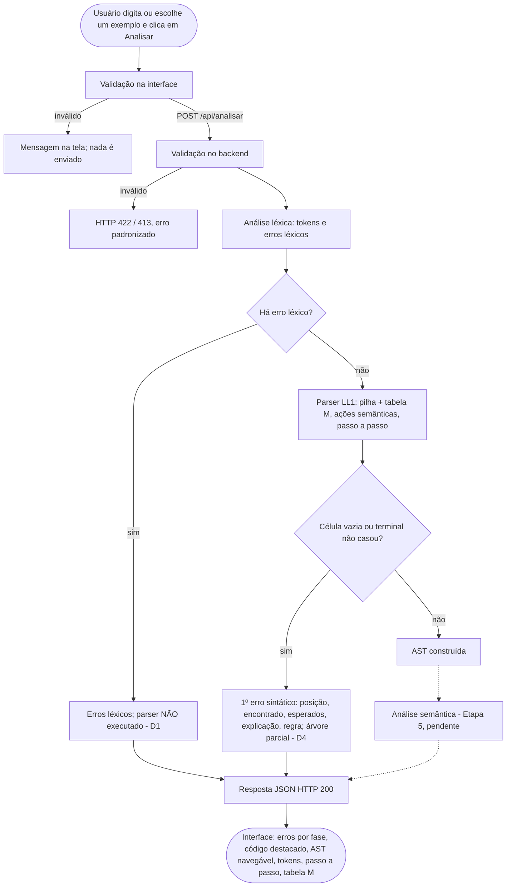

# Fluxograma do processamento

Figura para a seção **Materiais e Métodos** do artigo: [fluxograma.svg](fluxograma.svg) (vetorial) e [fluxograma.png](fluxograma.png) (para inserir no documento).

Legenda: verde = implementado; amarelo = decisão; vermelho = retorno de erro ao usuário; cinza tracejado = pendente (Etapa 5); azul = usuário e interface.

O mesmo fluxo, em texto (Mermaid):

Pontos de retorno de erro ao usuário, sempre em blocos separados: (i) validação da entrada; (ii) erros léxicos; (iii) erro sintático, com posição, tokens esperados e explicação; (iv) erros semânticos (Etapa 5, pendente).
